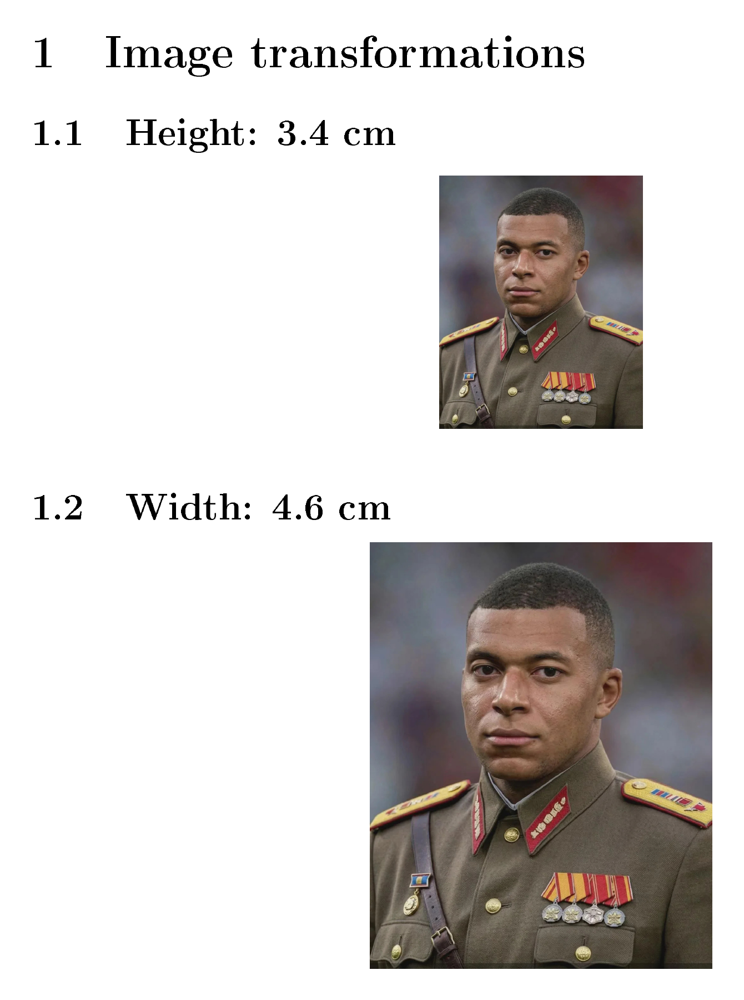
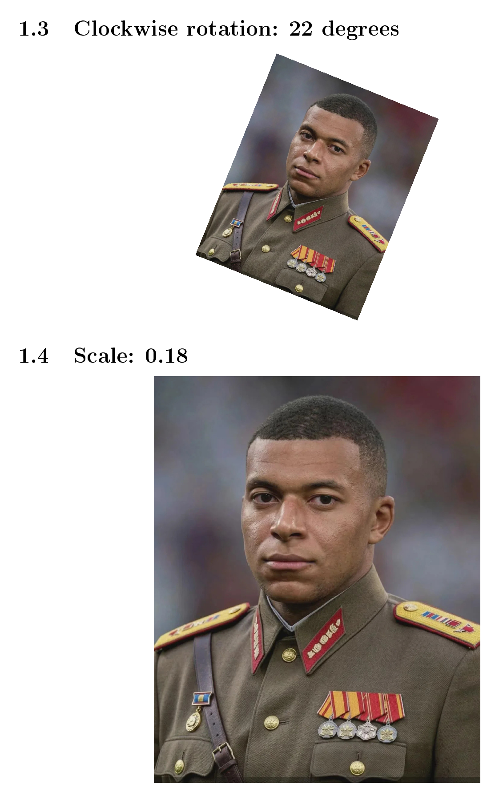
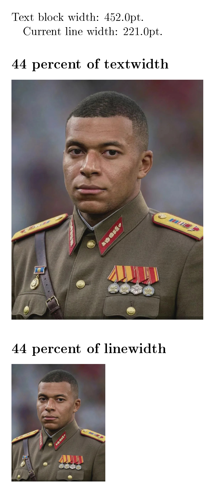
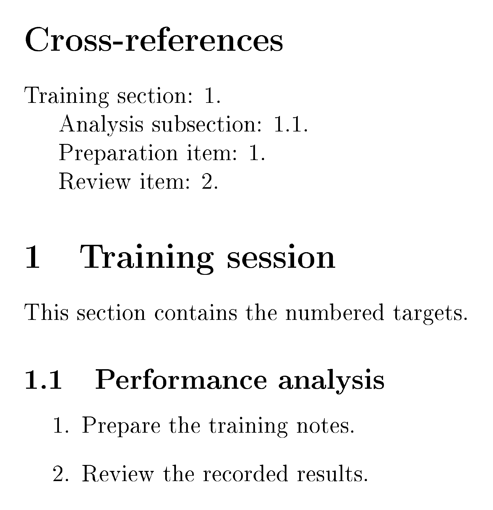

---
author:
  name: Зеро Антон Андреевич
  email: 1032259387@rudn.ru
  affiliation:
    - name: Российский университет дружбы народов
      country: Российская Федерация
      postal-code: 117198
      city: Москва
      address: ул. Миклухо-Маклая, д. 6

title: "Лабораторная работа № 4"
subtitle: "Набор математических формул в LaTeX"
license: CC BY
date: today
date-format: "DD.MM.YYYY"
header-includes:
  - "\\usepackage{unicode-math}"
---

## Докладчик

- Студент: Зеро Антон Андреевич
- Студенческий билет: 1032259387
- Российский университет дружбы народов
- Email: 1032259387@rudn.ru


## Цель и задачи

**Цель:** освоить работу с изображениями и ссылками в LaTeX.

- Вставить изображение и изменить его внешний вид.
- Сравнить ширину текстового блока и строки.
- Исследовать размещение плавающих объектов.
- Проверить нумерацию и положение меток.

## Материалы работы

- Восемь примеров главы: `inc-im1.tex`–`inc-im8.tex`.
- Шесть дополнительных исходников в `project/ex/`.
- Изображение: `pix/mbappe.jpg`.
- Сохранены PDF и вспомогательные файлы `.aux`.

| Пакет | Назначение |
|---|---|
| `graphicx` | Вставка и преобразование изображений |
| `lipsum` | Текст для опытов с размещением |
| `float` | Размещение с параметром `[H]` |
| `hyperref` | Кликабельные ссылки |

## Вставка изображения

:::: {.columns}
::: {.column width="55%"}

```latex
\usepackage{graphicx}
\includegraphics[height=2cm]
  {../pix/mbappe.jpg}
```

- В фигурных скобках — путь к файлу.
- В квадратных — параметры.
- `../` — родительский каталог.

:::
::: {.column width="45%"}

{height=55mm fig-alt="Изображение Мбаппе, вставленное в inc-im1.pdf"}

:::
::::

## Подпись и ссылка

```latex
\begin{figure}[h]
  \centering
  \includegraphics[height=4.2cm]
    {../../pix/mbappe.jpg}
  \caption{Portrait A: placement h.}
  \label{fig:placement-h}
\end{figure}
```

`figure` объединяет изображение и подпись. Метка после `\caption` сохраняет номер рисунка.

## Размер изображения

:::: {.columns}
::: {.column width="55%"}

В `ex2.tex` проверены:

- высота **3,4 см**;
- ширина **4,6 см**.

```latex
\includegraphics[height=3.4cm]
  {../../pix/mbappe.jpg}
\includegraphics[width=4.6cm]
  {../../pix/mbappe.jpg}
```

При задании одной размерности пропорции сохраняются.

:::
::: {.column width="45%"}

{height=58mm fig-alt="Первая страница ex2.pdf: высота и ширина изображения"}

:::
::::

## Поворот и масштаб

:::: {.columns}
::: {.column width="55%"}

```latex
\includegraphics[
  width=4cm,angle=-22,origin=c
]{../../pix/mbappe.jpg}
```

- Поворот **−22°**, по часовой стрелке.
- `origin=c` — центр поворота.
- Масштабы **0,18** и **0,28**.
- `scale` зависит от естественного размера файла.

:::
::: {.column width="45%"}

{height=58mm fig-alt="Вторая страница ex2.pdf: поворот и масштаб 0,18"}

:::
::::

## Обрезка изображения

В примере `inc-im3.tex`:

```latex
\includegraphics[clip,trim=0 0 50 50]
  {../pix/mbappe.jpg}
```

- `trim`: слева, снизу, справа, сверху.
- `clip` скрывает обрезанные части.
- Исходное изображение не изменяется.

## Ширина в двух колонках

:::: {.columns}
::: {.column width="55%"}

В `ex1.tex` используется `twocolumn`:

- `\textwidth` = **452 pt**;
- `\linewidth` = **221 pt**.

```latex
\includegraphics[width=0.44\textwidth]
  {../../pix/mbappe.jpg}
\includegraphics[width=0.44\linewidth]
  {../../pix/mbappe.jpg}
```

Один коэффициент даёт разную ширину.

:::
::: {.column width="45%"}

{height=58mm fig-alt="Сравнение 0,44 textwidth и linewidth в двухколоночном документе"}

:::
::::

## Плавающие рисунки

| Параметр | Разрешённое положение |
|---|---|
| `h` | Рядом с объявлением, если возможно |
| `t` | Верх страницы |
| `b` | Низ страницы |
| `p` | Страница плавающих объектов |

Это допустимые места, **не гарантированная позиция**.

## Сравнение размещения

:::: {.columns}
::: {.column width="55%"}

В `ex3.tex`:

- длинный текст из `lipsum`;
- пять рисунков высотой **4,2 см**;
- параметры `h`, `t`, `b`, `p`, `htbp`;
- маркеры A–E в местах объявления.

На размещение влияют свободное место и очередь рисунков. Справа — первая из пяти страниц.

:::
::: {.column width="45%"}

{height=58mm fig-alt="Маркер A и первый рисунок на первой странице ex3.pdf"}

:::
::::

## Фиксированное размещение

```latex
\usepackage{float}
\begin{figure}[H]
  ...
\end{figure}
```

- `[H]` размещает рисунок в текущей позиции текста.
- Если блок не помещается, он переносится целиком.
- Возможны пустые участки страницы.
- В `inc-im6.tex` пакет `trivfloat` создаёт тип `image`.

## Обновление ссылок

:::: {.columns}
::: {.column width="50%"}

В сохранённом `ex4.pdf`:

- раздел — **1**;
- подраздел — **1.1**;
- пункты — **1** и **2**.

Дополнительные элементы пока закомментированы. Метки хранятся в `.aux`; после изменений требуется повторная сборка.

:::
::: {.column width="50%"}

{height=52mm fig-alt="Ссылки на раздел, подраздел и пункты списка в ex4.pdf"}

:::
::::

## Метка рисунка

:::: {.columns}
::: {.column width="55%"}

| Метка | Рисунок | Ссылка |
|---|---:|---:|
| До подписи | 2 | **7** |
| После подписи | 3 | **3** |

```latex
\caption{An image}
\label{fig:example}
```

Номер устанавливает `\caption`. Значение **7** — номер раздела.

:::
::: {.column width="45%"}

{height=58mm fig-alt="Рисунки 2 и 3; ссылки 7 и 3 в ex5.pdf"}

:::
::::

## Метка формулы

Внутри первого `equation`: правильная ссылка **4**.

После второго `equation`: ссылка **7** вместо номера формулы **5**.

{height=40mm fig-alt="Формулы 4 и 5; ссылки 4 и 7 в ex6.pdf"}

**Метка формулы должна находиться внутри `equation`.**

## Кликабельные ссылки

```latex
\usepackage{hyperref}
\section{Next thing}
\label{sec:next}

See Section~\ref{sec:next}.
```

- В `inc-im8.tex` рассмотрены переходы по ссылкам.
- `~` связывает название объекта и номер неразрывным пробелом.
- Пакет `hyperref` обычно подключают после остальных пакетов.

## Выводы

- `graphicx` управляет вставкой и преобразованием изображений.
- Ширину рисунка выбирают с учётом строки или колонки.
- Перемещение рисунка — часть механизма вёрстки.
- Метку рисунка ставят после подписи, формулы — внутри окружения.
- После изменения нумерации документ пересобирают.


