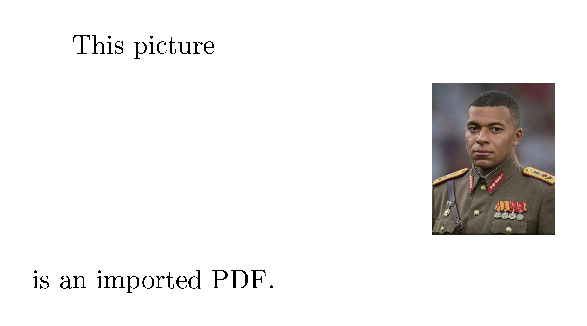
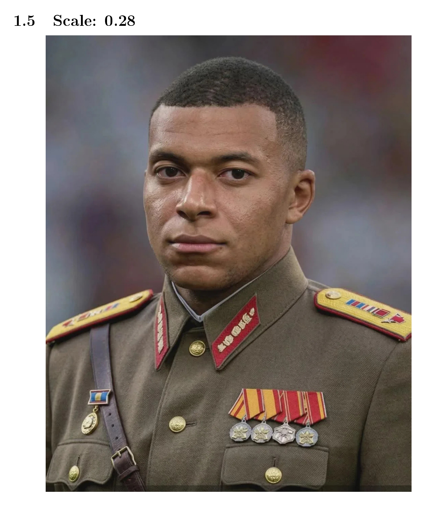
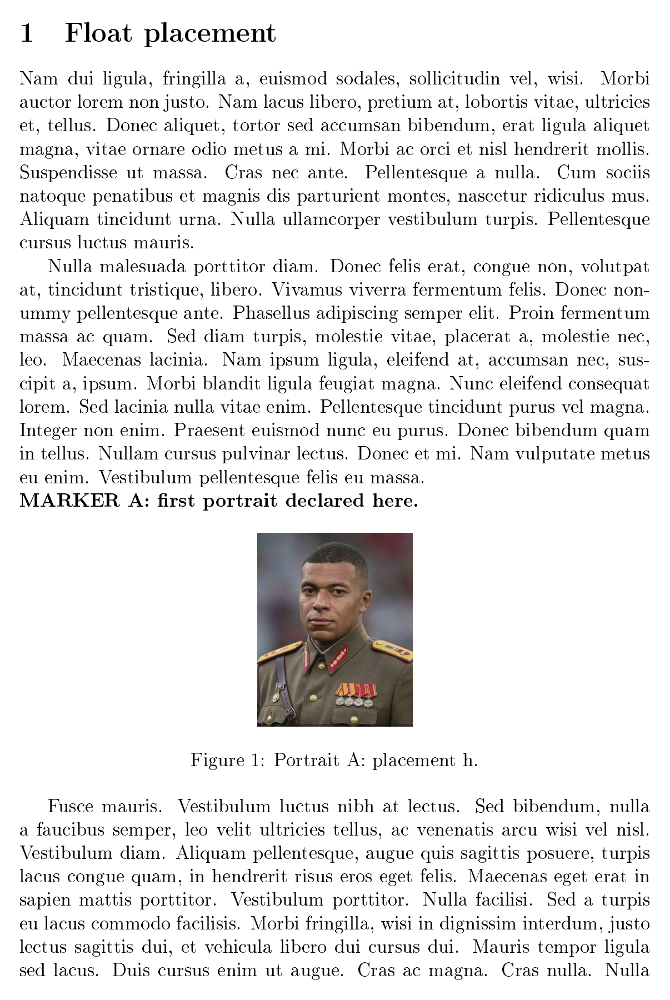
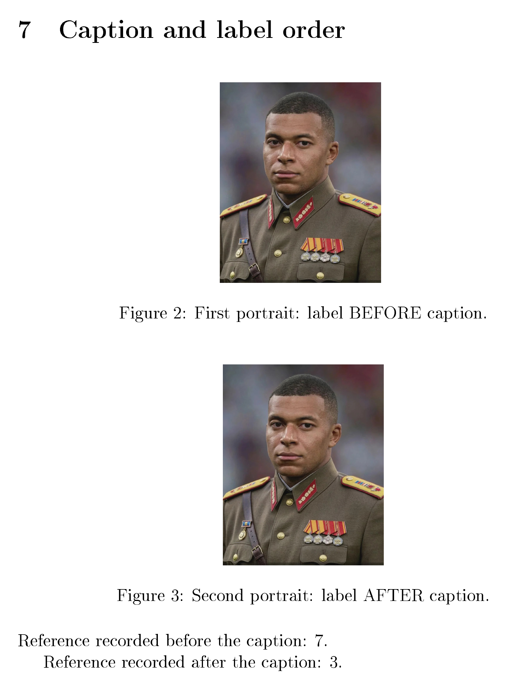
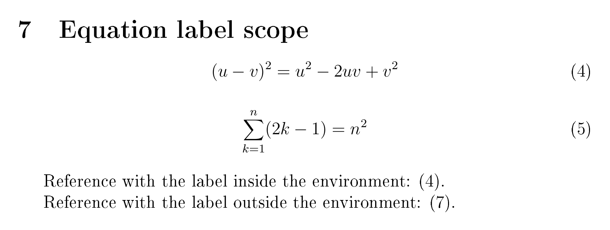

---
author:
  name: Зеро Антон Андреевич
  email: 1032259387@rudn.ru
  affiliation:
    - name: Российский университет дружбы народов
      country: Российская Федерация
      postal-code: 117198
      city: Москва
      address: ул. Миклухо-Маклая, д. 6

title: "Отчёт по лабораторной работе №4"
subtitle: "Набор математических формул в LaTeX"
license: "CC BY"
abstract: |
  В отчёте рассмотрены математические режимы LaTeX и средства пакетов amsmath,
  mathtools, amsfonts и bm. На примере исходного файла math.tex исследованы
  формулы в строке и отдельной строкой, выравнивания, матрицы, математические
  шрифты и полужирное начертание. Отдельно описан пример Unicode Math,
  использующий LuaLaTeX и OpenType-математический шрифт.
keywords:
  - лабораторная работа
  - LaTeX
  - математические формулы
  - amsmath
  - Unicode Math
---
# Введение

## Актуальность

В научном тексте важно не только включить изображение, но и подобрать его размер, добавить подпись и корректно сослаться на него. LaTeX позволяет задавать эти операции в исходном тексте и автоматически поддерживать нумерацию объектов.

## Цель работы

Освоить вставку изображений в LaTeX, управление их размерами и размещением, а также создание корректных перекрёстных ссылок.

## Задачи

1. Подключить выбранное изображение из файла.
2. Проверить параметры высоты, ширины, угла поворота и масштаба.
3. Сравнить ширину текстового блока и текущей строки.
4. Изучить размещение плавающих рисунков.
5. Рассмотреть обновление нумерации при повторной сборке.
6. Проверить метки перед подписью рисунка и после неё.
7. Проверить метки внутри и вне окружения формулы.

# Теоретическая часть

## Вставка и преобразование графики

Пакет `graphicx` предоставляет команду `\includegraphics`. В фигурных скобках указывается путь к файлу, в квадратных — параметры изображения. `height` задаёт высоту, `width` — ширину, `angle` — угол поворота, `scale` — масштаб относительно естественного размера. При задании одной размерности пропорции сохраняются.

Величина `\textwidth` обозначает ширину текстового блока, а `\linewidth` — доступную ширину текущей строки. В двухколоночном документе эти размеры различаются. Параметр `trim` задаёт обрезку слева, снизу, справа и сверху; `clip` скрывает части за границами выбранной области.

## Плавающие объекты

Окружение `figure` объединяет изображение и подпись в плавающий объект. Параметры `h`, `t`, `b`, `p` разрешают размещение около объявления, сверху, снизу или на странице плавающих объектов. Это допустимые позиции, а не гарантированное расположение. На результат влияют свободное место и очередь рисунков.

Внутри `figure` для центрирования используется `\centering`. Команда `\caption` создаёт подпись и устанавливает номер рисунка. Параметр `[H]` пакета `float` размещает рисунок в текущей позиции потока текста, но при недостатке места блок может перейти на следующую страницу.

## Перекрёстные ссылки

Команда `\label` сохраняет текущий номер объекта, а `\ref` подставляет его в текст. Сведения записываются во вспомогательный файл `.aux` и используются при следующем запуске. Для нового документа обычно нужны два прохода LaTeX.

Метка рисунка должна находиться после `\caption` внутри `figure`, а метка формулы — внутри `equation`. Пакет `hyperref` превращает ссылки в кликабельные переходы.

# Материалы и методы

Работа выполнена в Windows с использованием Git Bash, TeX Live и pdfLaTeX. Основные пакеты — `graphicx`, `lipsum` и `float`. В примерах главы также рассмотрены `trivfloat` и `hyperref`.

В каталоге `labs/lab04/project/` сохранены восемь примеров `inc-im1.tex`–`inc-im8.tex` и результаты их сборки. Дополнительные эксперименты находятся в `labs/lab04/project/ex/`: `ex1.tex`–`ex6.tex`. Номера этих файлов не совпадают с номерами упражнений методички.

Для изображений используется файл `labs/lab04/pix/mbappe.jpg`. В примерах из `project/` путь имеет вид `../pix/mbappe.jpg`, а из вложенного каталога `project/ex/` — `../../pix/mbappe.jpg`.

Метод работы: подготовка отдельного исходника, компиляция, просмотр PDF и проверка меток по `.aux`. Иллюстрации ниже получены из сохранённых PDF. Для многостраничных документов указано, какой фрагмент представлен.

# Выполнение лабораторной работы

## 1. Вставка изображения

В файле `inc-im1.tex` пакет `graphicx` подключает изображение высотой 2 см. Для центрирования используется окружение `center`:

```latex
\begin{center}
\includegraphics[height=2cm]{../pix/mbappe.jpg}
\end{center}
```

На @fig-insertion показан сохранённый результат. Подключён файл JPG; английская фраза «is an imported PDF» в учебном исходнике осталась от примера методички и не обозначает фактический формат изображения.

{#fig-insertion width=65%}

Использована выбранная фотография. Требование упражнения о собственноручно созданном изображении отдельно этим примером не подтверждается.

## 2. Размер, поворот и масштаб

В `project/ex/ex2.tex` рассмотрены высота 3,4 см, ширина 4,6 см, поворот на −22° относительно центра и масштабы 0,18 и 0,28:

```latex
\includegraphics[height=3.4cm]{../../pix/mbappe.jpg}
\includegraphics[width=4.6cm]{../../pix/mbappe.jpg}
\includegraphics[width=4cm,angle=-22,origin=c]
  {../../pix/mbappe.jpg}
\includegraphics[scale=0.18]{../../pix/mbappe.jpg}
\includegraphics[scale=0.28]{../../pix/mbappe.jpg}
```

При задании только высоты или ширины пропорции сохраняются. Отрицательный угол задаёт поворот по часовой стрелке. `scale` изменяет естественный размер изображения, поэтому результат зависит от исходного файла.

Первая страница результата содержит сравнение высоты и ширины (@fig-size). Вторая показывает поворот и масштаб 0,18 (@fig-rotation). На третьей приведён масштаб 0,28 (@fig-scale).

{#fig-size height=90mm}

{#fig-rotation height=90mm}

{#fig-scale height=90mm}

В дополнительном примере `inc-im3.tex` рассмотрена обрезка командой `\includegraphics[clip,trim=0 0 50 50]{../pix/mbappe.jpg}`. Исходный файл изображения при этом не изменяется.

## 3. Ширина в двух колонках

В `project/ex/ex1.tex` включён параметр `twocolumn`. Сравниваются изображения шириной `0.44\textwidth` и `0.44\linewidth`:

```latex
\documentclass[a4paper,12pt,twocolumn]{article}
\includegraphics[width=0.44\textwidth]{../../pix/mbappe.jpg}
\includegraphics[width=0.44\linewidth]{../../pix/mbappe.jpg}
```

В сохранённом результате ширина текстового блока равна 452 pt, а текущей строки — 221 pt. Поэтому одинаковый коэффициент даёт разные размеры: 198,88 pt и 97,24 pt соответственно. Первое изображение шире второго (@fig-columns).

{#fig-columns height=100mm}

Для изображения внутри колонки необходимо учитывать её доступную ширину. Отдельный одноколоночный результат в сохранённом комплекте экспериментов отсутствует, поэтому здесь показан двухколоночный вариант.

## 4. Плавающие рисунки

В `project/ex/ex3.tex` длинный текст создан пакетом `lipsum`. Пять изображений высотой 4,2 см имеют параметры `h`, `t`, `b`, `p` и `htbp`. Маркеры A–E обозначают позиции объявления рисунков в исходнике.

```latex
\begin{figure}[h]
  \centering
  \includegraphics[height=4.2cm]{../../pix/mbappe.jpg}
  \caption{Portrait A: placement h.}
  \label{fig:placement-h}
\end{figure}
```

Параметры задают разрешённые места, а не фиксируют положение. Рисунки могут задерживать размещение следующих объектов того же типа. В конце документа `\clearpage` выводит накопившиеся плавающие объекты.

На @fig-floats приведена первая страница пятистраничного результата: видны маркер A и первый рисунок. Остальные варианты размещения находятся на следующих страницах `ex3.pdf`.

{#fig-floats height=115mm}

В `inc-im5.tex` дополнительно рассмотрен параметр `[H]` пакета `float`, а в `inc-im6.tex` пакет `trivfloat` создаёт тип окружения `image`.

## 5. Метки и повторная сборка

В `project/ex/ex4.tex` заданы метки раздела, подраздела и двух пунктов списка. В сохранённых PDF и `.aux` раздел имеет номер 1, подраздел — 1.1, пункты — 1 и 2 (@fig-references).

{#fig-references width=85%}

Строки дополнительного раздела, подраздела и пункта списка в исходнике закомментированы. Поэтому сохранённый результат показывает исходную нумерацию, а не её изменение после вставок.

LaTeX записывает метки в `.aux` и читает их при следующем запуске. Для новых или изменённых ссылок обычно требуется повторная компиляция. Промежуточный PDF первого прохода отдельно не сохранён; число фактических запусков по итоговому PDF не устанавливается.

## 6. Метка до и после подписи

В `project/ex/ex5.tex` номер раздела намеренно равен 7, а номера рисунков — 2 и 3. Метка перед `\caption` первого рисунка получает значение 7 вместо 2. Метка после подписи второго рисунка получает правильное значение 3 (@fig-caption-label).

{#fig-caption-label height=110mm}

Номер рисунка устанавливается при обработке `\caption`. Поэтому `\label` нужно ставить после подписи внутри `figure`. Ошибка положения метки не обязательно мешает компиляции, но делает ссылку неверной.

| Положение метки | Номер рисунка | Значение ссылки |
|---|---:|---:|
| Перед `\caption` | 2 | 7 — номер раздела |
| После `\caption` | 3 | 3 — правильно |

## 7. Метка внутри и вне формулы

В `project/ex/ex6.tex` приведены две формулы:

\[
(u-v)^2=u^2-2uv+v^2,
\qquad \sum_{k=1}^{n}(2k-1)=n^2.
\]

Метка внутри первого `equation` получает правильный номер 4. Метка после закрытия второй формулы получает номер раздела 7, хотя сама формула имеет номер 5. Эти значения подтверждаются `ex6.aux` и результатом на @fig-equation-label.

{#fig-equation-label width=90%}

Для правильной ссылки метка должна находиться в области действия нужного номера, то есть внутри `equation`. Перенос внешней метки перед `\end{equation}` и повторная сборка должны дать ссылку на номер 5; исправленный вариант в представленном комплекте отдельно не сохранён.

# Результаты

| Опыт | Сохранённый результат |
|---|---|
| Вставка изображения | JPG подключён в `inc-im1.pdf` |
| Размер и поворот | 3,4 см; 4,6 см; −22°; масштабы 0,18 и 0,28 |
| Две колонки | Ширина блока 452 pt, строки 221 pt |
| Плавающие объекты | Пять рисунков с параметрами `h`, `t`, `b`, `p`, `htbp` |
| Нумерованные элементы | Раздел 1, подраздел 1.1, пункты 1 и 2 |
| Метки рисунков | Неправильная ссылка 7, правильная 3 |
| Метки формул | Правильная ссылка 4, неправильная 7 |

# Обсуждение результатов

При выборе размера необходимо учитывать контекст вёрстки. В двух колонках `\linewidth` соответствует текущей колонке, тогда как `\textwidth` описывает весь текстовый блок. Это различие объясняет неодинаковую ширину изображений при одном коэффициенте.

Окружение `figure` предоставляет механизм плавающего размещения. Перемещение рисунка относительно исходного текста не обязательно является ошибкой. Параметр `[H]` может быть полезен для отдельных примеров, но способен оставлять пустое пространство.

Эксперименты с метками показывают, что успешная сборка не гарантирует правильность ссылки. В неправильных вариантах сохраняется номер раздела 7 вместо номера рисунка или формулы.

# Заключение

Рассмотрены вставка графики из файла, изменение размеров, масштабирование и поворот. Пакет `graphicx` позволяет управлять этими операциями непосредственно в исходном тексте.

Проверены различия между шириной текстового блока и строки, размещение плавающих рисунков и правила формирования ссылок. Метку рисунка следует помещать после `\caption`, а метку формулы — внутри `equation`.

Цель достигнута в части сохранённых примеров. Для полного документирования упражнений следует дополнительно сохранить одноколоночный вариант, результаты изменения нумерации и промежуточный первый проход сборки.

